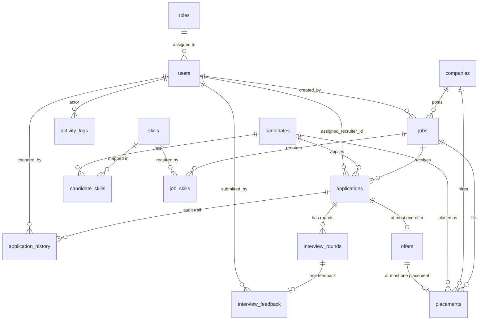

# Entity-Relationship Diagram

Source of truth: `database/database_schema.sql` (17 tables, Database Design Specification sections 3-4).

Key constraints: `applications` is UNIQUE on (candidate_id, job_id); `interview_rounds` is UNIQUE on (application_id, round_number); `interview_feedback.interview_id` and `offers.application_id` are UNIQUE; `candidates.email` and `candidates.mobile` are UNIQUE; percentages are CHECKed to 0-100.
